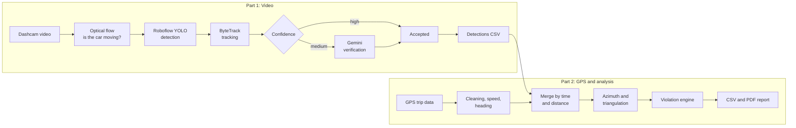

# 🚦 Traffic Sign Detection & Fleet Safety Analysis

A two-part Python system that turns dashcam footage and GPS data into a driving safety report. **Part 1** detects, tracks, and verifies road signs in video. **Part 2** places the signs on the map, cross-references them with the vehicle's GPS trip, and flags violations such as speeding or not stopping at a stop sign.


## How It Works



## Part 1: Sign Detection (`part1/`)

- **Motion gate:** Farneback optical flow on the road region decides whether the vehicle is actually moving, so no API calls are wasted while stopped or when only another car passes by.
- **Detection and tracking:** every 3rd frame is sent to a Roboflow-hosted YOLO model, and `supervision`'s ByteTrack gives each physical sign a stable ID across frames.
- **Confidence gating:** low-confidence detections are dropped, high-confidence ones are accepted, and the uncertain middle range is verified by **Gemini**, which returns a structured JSON verdict and rejects ads, stickers, reflections, and screens.
- **Output:** the best crop per sign (`detected_crops/`), a per-detection log with bounding boxes and timestamps, and for each sign the two frames with the widest viewing angle (`sign_detections_for_angle.csv`) for triangulation.
- **Labels:** 47 sign classes mapped from French to English in `labels_map.json`.

| File | Role |
|---|---|
| `main.py` | Pipeline entry point |
| `yolo_engine.py` | Roboflow inference and ByteTrack tracking |
| `gemini_agent.py` | Gemini verification of uncertain detections |
| `optical_flow_processor.py` | Vehicle-motion detection |
| `state_manager.py` | Thread-safe per-sign state and best-image selection |
| `detection_logger.py` | Per-detection log and best-frame selection |
| `translator_service.py` | Class ID to English label |

## Part 2: GPS and Violation Analysis (`part2/data/`)

- **GPS processing:** distance and speed between points, removal of impossible speed spikes, gap handling, stop detection, and vehicle heading.
- **Merging:** detections are matched to the GPS trip using a time window and a distance threshold.
- **Geometry:** the sign's bearing is computed from its position in the frame and the camera's horizontal field of view, then its location is estimated by triangulating it from multiple frames (Israeli coordinate system, EPSG:2039). A KD-tree finds signs near the vehicle.
- **Violation engine:** rule-based checks for speed limits, stop signs, yield and crosswalk signs, and no-entry or no-U-turn signs. Output is `violations_report.csv` and a PDF safety report.

| File | Role |
|---|---|
| `main.py` | Processing pipeline entry point |
| `processor.py` | GPS cleaning, speed, stops, heading |
| `merger.py` | Merge detections with GPS |
| `geometry_processor.py` | Relative and absolute azimuth |
| `spatial_analyzer.py` | Projection, triangulation, nearby-sign lookup |
| `violation_engine.py` | Violation rules and PDF report |
| `generate_data.py` | Sample GPS and sign data for testing |

## Getting Started

**Requirements:** Python 3.10+

### Part 1

```bash
cd part1
python -m venv .venv
.venv\Scripts\activate          # macOS/Linux: source .venv/bin/activate
pip install -r requirements.txt
```

Create a `.env` file (see `.env.example`):

```env
ROBOFLOW_API_KEY=your_key
ROBOFLOW_MODEL_ID=your-project/version
GEMINI_API_KEY=your_key
```

Place a dashcam video named `video.mp4` in `part1/`, set `VIDEO_START_WALLTIME` in `main.py` to the real start time of the recording (it must match the GPS clock), and run:

```bash
python main.py
```

### Part 2

```bash
cd part2
pip install -r data/requirements.txt
python data/main.py
```

Part 2 reads the GPS trip file and the detections produced by Part 1 from the `data/` folder. See `main.py` for the exact file names.

## Notes

- Keys are read from environment variables and are never stored in the repository.
- SSL certificate verification is disabled in several places so the project can run behind a filtered network. Re-enable it for any real deployment.
- Violation rules are intentionally simple and meant for demonstration.

## Authors

Built together by [@t0556746399-a11y](https://github.com/t0556746399-a11y) and Hadas.
